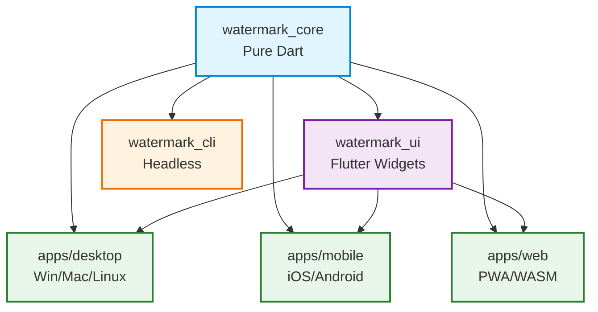

# JCV Watermarker - Multi-Project Architecture Design

## Overview

This document describes the proposed multi-project architecture for the JCV Watermarker application. The current codebase is a single Flutter Windows app. The goal is to restructure it into a **monorepo** with:

1. **Shared packages** - Reusable core logic (watermark engine, models, file formats)
2. **Platform-specific apps** - Windows, macOS, Linux, Web, iOS, Android
3. **Common UI components** - Shared widgets and design system

---

## Current State Analysis

### Existing Structure (`flutter_app/`)
```
flutter_app/
├── lib/
│   ├── main.dart           # App entry point, theme, MaterialApp
│   ├── home_page.dart      # Main UI (4136 lines) - settings, preview, save
│   ├── models.dart         # Data models (LogoItem, TextItem, Placement, etc.)
│   ├── watermark_engine.dart # Pure Dart rendering engine (WatermarkRequest, renderWatermark)
│   └── preview_worker.dart # Background isolate for live previews
├── assets/                 # App icons, default logos
├── pubspec.yaml
└── README.md
```

### Key Observations
- **watermark_engine.dart** is pure Dart with no Flutter dependencies (except `package:image`)
- **models.dart** contains only data classes
- **preview_worker.dart** uses isolates but depends on watermark_engine
- **home_page.dart** is the monolithic UI with all business logic mixed in
- Export/Import (.jcv format) logic lives in home_page.dart

---

## Target Architecture

```
jcv-watermarker/
├── packages/
│   ├── watermark_core/          # Pure Dart: models, engine, file format
│   ├── watermark_ui/            # Flutter: shared widgets, theme, components
│   └── watermark_cli/           # Optional: CLI tool for headless processing
├── apps/
│   ├── desktop/                 # Windows, macOS, Linux (single Flutter project)
│   ├── mobile/                  # iOS, Android (single Flutter project)
│   └── web/                     # Web (PWA)
├── tool/                        # Build scripts, code generation
└── melos.yaml                   # Monorepo management (or use native Flutter workspace)
```

---

## Package: `watermark_core` (Pure Dart)

**Purpose**: All business logic that can run without Flutter. Zero Flutter dependencies.

### Structure
```
packages/watermark_core/
├── lib/
│   ├── watermark_core.dart      # Main export
│   ├── models/
│   │   ├── logo_item.dart
│   │   ├── text_item.dart
│   │   ├── placement.dart
│   │   ├── export_mode.dart
│   │   ├── text_image_pos.dart
│   │   └── models.dart          # Barrel export
│   ├── engine/
│   │   ├── watermark_request.dart
│   │   ├── watermark_engine.dart    # renderWatermark, _drawRow, _drawGradient, etc.
│   │   ├── image_src.dart
│   │   ├── decoded_cache.dart
│   │   ├── text_overlay.dart
│   │   └── downscale.dart
│   ├── format/
│   │   ├── project_file.dart        # .jcv import/export logic
│   │   ├── settings_schema.dart     # JSON schema for settings
│   │   └── version.dart             # Format versioning
│   ├── persistence/
│   │   ├── app_storage.dart         # Abstract storage interface
│   │   ├── shared_prefs_storage.dart # SharedPreferences impl
│   │   └── file_storage.dart        # File system impl
│   └── utils/
│       ├── image_signature.dart
│       ├── name_dedup.dart
│       └── color_utils.dart
├── test/
└── pubspec.yaml                 # deps: image, archive, path_provider, shared_preferences
```

### Public API
```dart
// Core rendering
Uint8List renderWatermark(WatermarkRequest request, {DecodedCache? cache});

// Project file I/O
Future<ProjectFile> exportProject(ProjectData data, ExportMode mode);
Future<ProjectData> importProject(Uint8List jcvBytes);

// Settings persistence
abstract class AppStorage {
  Future<void> saveSettings(Settings settings);
  Future<Settings?> loadSettings();
  Future<void> saveHistory(List<HistoryEntry> history);
  Future<List<HistoryEntry>> loadHistory();
}

// Models (serializable)
@JsonSerializable()
class LogoItem { ... }
@JsonSerializable()
class TextItem { ... }
@JsonSerializable()
class WatermarkRequest { ... }
```

---

## Package: `watermark_ui` (Flutter)

**Purpose**: Reusable UI components, theme, and widgets shared across platforms.

### Structure
```
packages/watermark_ui/
├── lib/
│   ├── watermark_ui.dart        # Main export
│   ├── theme/
│   │   ├── app_theme.dart       # ThemeData builder (Segoe UI, colors, etc.)
│   │   ├── colors.dart          # Color tokens, gradients
│   │   └── typography.dart      # Text styles
│   ├── widgets/
│   │   ├── sidebar/
│   │   │   ├── settings_sidebar.dart
│   │   │   ├── section_widget.dart
│   │   │   ├── logo_section.dart
│   │   │   ├── text_section.dart
│   │   │   └── sliders/
│   │   ├── preview/
│   │   │   ├── preview_pane.dart
│   │   │   ├── thumbnail_strip.dart
│   │   │   └── fullscreen_viewer.dart
│   │   ├── action_bar.dart
│   │   ├── color_picker/
│   │   │   ├── color_field.dart
│   │   │   ├── color_panel.dart
│   │   │   └── swatch_picker.dart
│   │   ├── common/
│   │   │   ├── thumb_widget.dart
│   │   │   ├── number_field.dart
│   │   │   ├── alignment_chooser.dart
│   │   │   └── badge.dart
│   │   └── dialogs/
│   │       ├── export_dialog.dart
│   │       ├── import_dialog.dart
│   │       └── confirm_dialog.dart
│   ├── providers/
│   │   ├── project_provider.dart    # Riverpod/Provider state management
│   │   ├── preview_provider.dart
│   │   └── settings_provider.dart
│   └── utils/
│       ├── responsive.dart
│       └── scroll_behavior.dart
├── test/
└── pubspec.yaml                 # deps: flutter, watermark_core, provider/riverpod
```

### State Management Strategy
- Use **Riverpod** for cross-platform state management
- `ProjectProvider` holds: photos, logos, texts, settings
- `PreviewProvider` manages preview worker and render queue
- `SettingsProvider` handles persistence

---

## Package: `watermark_cli` (Optional)

**Purpose**: Headless batch processing for CI/CD, servers, automation.

```dart
// bin/watermark_cli.dart
void main(List<String> args) {
  // Parse args: input dir, output dir, project file, options
  // Load .jcv project
  // Process all images
  // Write results
}
```

---

## App: `desktop` (Windows, macOS, Linux)

### Structure
```
apps/desktop/
├── lib/
│   ├── main.dart                # Entry point
│   ├── desktop_app.dart         # MaterialApp with desktop theme
│   ├── windows/
│   │   └── windows_integration.dart  # File associations, jump lists
│   ├── macos/
│   │   └── macos_integration.dart    # Menu bar, document model
│   └── linux/
│       └── linux_integration.dart    # DBus, file associations
├── windows/                     # Flutter Windows config
├── macos/                       # Flutter macOS config
├── linux/                       # Flutter Linux config
├── pubspec.yaml                 # deps: flutter, watermark_ui, watermark_core
└── CMakeLists.txt               # Platform-specific build config
```

### Platform-Specific Features
| Feature | Windows | macOS | Linux |
|---------|---------|-------|-------|
| File associations | ✅ | ✅ | ✅ |
| Native menus | ❌ | ✅ | ❌ |
| System tray | ✅ | ✅ | ✅ |
| Jump lists / recent | ✅ | ✅ | ❌ |
| Dark mode sync | ✅ | ✅ | ⚠️ |

---

## App: `mobile` (iOS, Android)

### Structure
```
apps/mobile/
├── lib/
│   ├── main.dart
│   ├── mobile_app.dart
│   ├── home/
│   │   ├── mobile_home_page.dart    # Adapted for touch/small screens
│   │   ├── bottom_nav_bar.dart
│   │   └── floating_action_button.dart
│   ├── settings/
│   │   └── mobile_settings_sheet.dart  # Bottom sheet instead of sidebar
│   └── preview/
│       └── mobile_preview.dart
├── ios/                         # Flutter iOS config
├── android/                     # Flutter Android config
└── pubspec.yaml
```

### Mobile Adaptations
- **Sidebar → Bottom Sheet / Modal** for settings
- **Hover → Long press** for thumbnails
- **Mouse wheel zoom → Pinch gesture**
- **Keyboard shortcuts → Touch gestures**
- **File picker → Platform image picker + document picker**

---

## App: `web` (PWA)

### Structure
```
apps/web/
├── lib/
│   ├── main.dart
│   ├── web_app.dart
│   └── web_integration.dart     # Service worker, file system access API
├── web/
│   ├── index.html
│   ├── manifest.json
│   └── sw.js                    # Service worker for offline
└── pubspec.yaml
```

### Web Considerations
- **Isolates → Web Workers** (preview_worker needs adaptation)
- **File system → File System Access API** (or fallback to download/upload)
- **Drag & drop** for photo/logo import
- **PWA** for installability
- **WASM** compilation for performance

---

## Shared Tooling

### melos.yaml (Monorepo Management)
```yaml
name: jcv_watermarker
packages:
  - packages/*
  - apps/*
scripts:
  bootstrap: melos bootstrap
  test: melos run test
  analyze: melos run analyze
  format: melos run format
  build:desktop: melos run build --scope=desktop
  build:mobile: melos run build --scope=mobile
  build:web: melos run build --scope=web
```

### Version Strategy
- **watermark_core**: Independent versioning (semver)
- **watermark_ui**: Tied to core version
- **Apps**: Independent versioning per platform
- Use **Git tags** per app: `windows-v1.0.0`, `ios-v1.0.0`, `web-v1.0.0`

---

## Migration Path

### Phase 1: Extract Core (Week 1-2)
1. Create `packages/watermark_core`
2. Move `models.dart` → `watermark_core/models/`
3. Move `watermark_engine.dart` → `watermark_core/engine/`
4. Extract `.jcv` import/export from `home_page.dart` → `watermark_core/format/`
5. Extract persistence logic → `watermark_core/persistence/`
6. Add tests for engine and file format
7. Update `flutter_app` to depend on `watermark_core`

### Phase 2: Extract UI (Week 2-3)
1. Create `packages/watermark_ui`
2. Extract theme from `main.dart` → `watermark_ui/theme/`
3. Break `home_page.dart` into widgets:
   - `SettingsSidebar` with sections
   - `PreviewPane` with thumbnail strip
   - `ActionBar`
   - Dialogs
4. Add state management (Riverpod providers)
5. Update `flutter_app` to use `watermark_ui` widgets

### Phase 3: Platform Apps (Week 3-4)
1. Create `apps/desktop` from current `flutter_app`
2. Platform-specific integrations
3. Create `apps/mobile` with adapted UI
4. Create `apps/web` with WASM and PWA

### Phase 4: Polish (Week 4+)
1. CI/CD for all platforms
2. Automated releases
3. Documentation
4. Performance optimization

---

## Dependency Graph



See also: [architecture_diagram.html](architecture_diagram.html) for an interactive visual diagram.

---

## Key Design Decisions

### 1. Pure Dart Core
- **Why**: Reusable in CLI, server, FFI, other languages
- **Trade-off**: No Flutter APIs (BuildContext, Image widgets) - use `package:image` instead

### 2. Single Desktop App (not 3)
- **Why**: Flutter desktop supports Windows/macOS/Linux from one codebase
- **Platform channels** only for deep OS integration (file associations, menus)

### 3. Riverpod for State
- **Why**: Compile-safe, testable, works across all platforms
- **Alternative**: Provider or Bloc - but Riverpod is more modern

### 4. Monorepo with Melos
- **Why**: Atomic commits, shared tooling, easy cross-package refactoring
- **Alternative**: Separate repos - but higher maintenance burden

### 5. Format Versioning in Core
- **Why**: .jcv files must be readable across versions/platforms
- **Strategy**: Semantic versioning in file header, migration functions in core

---

## File Format: .jcv Specification

```
JCV Project File (ZIP archive)
├── settings.json          # All settings + text templates
├── photos/                # Only in full export
│   ├── photo_0.jpg
│   └── photo_1.png
├── logos/
│   ├── bottom/
│   │   └── logo_name.png
│   ├── top/
│   │   └── logo_name.png
│   └── corner/
│       └── logo_name.png
└── textimg/
    └── text_<id>.png      # Rasterized text images
```

**settings.json schema**:
```json
{
  "version": 1,
  "logoSize": 22,
  "leftMargin": 1,
  "opacity": 90,
  "bottomMargin": 2,
  "topMargin": 2,
  "cornerHeight": 22,
  "cornerMargin": 2,
  "centered": false,
  "spacing": 0,
  "bottomGradient": false,
  "topGradient": false,
  "topGradientHeight": 22,
  "bottomGradientHeight": 22,
  "gradientColor": 4278190080,
  "gradientOpacity": 1.0,
  "bottom": [{"path": "...", "name": "logo.png"}],
  "top": [{"path": "...", "name": "logo.png"}],
  "corner": {"path": "...", "name": "logo.png"},
  "textTemplate": {...},
  "texts": [{...}, {...}],
  "photoCount": 5,
  "exportMode": 1
}
```

---

## Testing Strategy

### Unit Tests (watermark_core)
- `renderWatermark` with various configurations
- Gradient rendering
- Text overlay positioning
- .jcv import/export round-trip
- Logo deduplication logic

### Widget Tests (watermark_ui)
- Settings sidebar interactions
- Preview pane rendering
- Color picker
- Responsive layouts

### Integration Tests (apps/)
- Full workflow: add photos → add logos → adjust → save
- Platform-specific: file associations, native dialogs
- Performance: large batch processing

### Golden Tests
- Preview rendering consistency across platforms
- Theme variants (light/dark)

---

## CI/CD Pipeline

```yaml
# .github/workflows/ci.yml
jobs:
  core:
    runs-on: ubuntu-latest
    steps:
      - test: watermark_core
      - analyze: watermark_core
  
  ui:
    runs-on: ubuntu-latest
    needs: core
    steps:
      - test: watermark_ui
      - analyze: watermark_ui
  
  desktop-windows:
    runs-on: windows-latest
    needs: ui
    steps:
      - build: desktop (Windows)
      - test: integration (Windows)
      - artifact: ZIP release
  
  desktop-macos:
    runs-on: macos-latest
    needs: ui
    steps:
      - build: desktop (macOS)
      - notarize
      - artifact: DMG release
  
  desktop-linux:
    runs-on: ubuntu-latest
    needs: ui
    steps:
      - build: desktop (Linux)
      - artifact: AppImage/Tarball
  
  mobile-android:
    runs-on: ubuntu-latest
    needs: ui
    steps:
      - build: mobile (Android)
      - test: emulator
      - artifact: AAB/APK
  
  mobile-ios:
    runs-on: macos-latest
    needs: ui
    steps:
      - build: mobile (iOS)
      - test: simulator
      - artifact: IPA
  
  web:
    runs-on: ubuntu-latest
    needs: ui
    steps:
      - build: web (WASM)
      - deploy: GitHub Pages / Firebase
```

---

## Future Extensibility

### Plugin System (Post-MVP)
```
packages/watermark_plugins/
├── watermark_plugin_api.dart    # Interface for plugins
├── text_effects/                # Curved text, shadows, etc.
├── logo_effects/                # Borders, shadows, reflections
└── export_formats/              # PNG, WebP, TIFF, PDF
```

### Cloud Sync (Post-MVP)
- Firebase/Appwrite backend
- Project sync across devices
- Collaboration (shared projects)

### AI Features (Post-MVP)
- Auto logo placement (detect empty space)
- Text suggestion (OCR from photos)
- Smart batch naming

---

## Summary

| Layer | Package/App | Platform | Dependencies |
|-------|-------------|----------|--------------|
| Core | `watermark_core` | Any (Dart) | `image`, `archive`, `path_provider` |
| UI | `watermark_ui` | Flutter | `watermark_core`, `flutter`, `riverpod` |
| CLI | `watermark_cli` | Any (Dart) | `watermark_core`, `args` |
| Desktop | `apps/desktop` | Win/Mac/Linux | `watermark_ui`, `watermark_core` |
| Mobile | `apps/mobile` | iOS/Android | `watermark_ui`, `watermark_core` |
| Web | `apps/web` | Browser (WASM) | `watermark_ui`, `watermark_core` |

This architecture enables:
- **Code reuse**: 80%+ shared logic
- **Platform optimization**: Native feel on each platform
- **Independent releases**: Ship desktop without mobile
- **Team scaling**: Separate teams per platform/app
- **Future-proof**: Easy to add new platforms or features